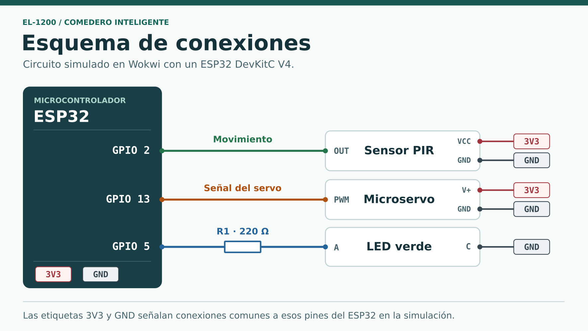
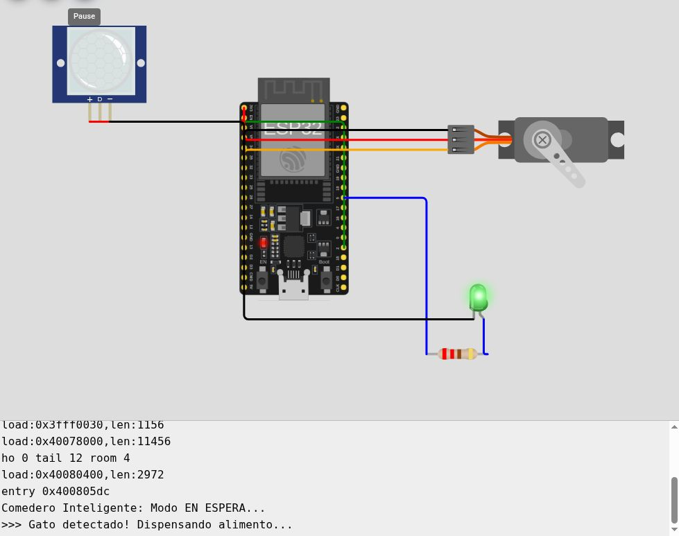
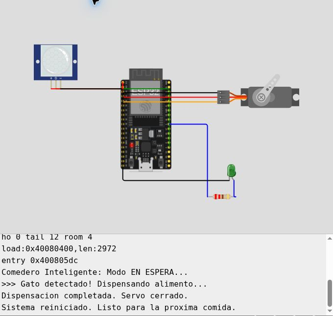

# Comedero inteligente para gatos

Proyecto individual de **Isaac Vargas Moya** para **EL-1200 Introducción a la Electrónica**, Tecnológico de Costa Rica, II semestre de 2026.

El comedero abre una compuerta cuando el sensor detecta movimiento frente al plato. Sirve una sola porción por activación del sensor, aunque la señal permanezca activa.

**[Abrir el comedero en Wokwi](https://wokwi.com/projects/481363038394430465)**

## Funcionamiento

En reposo, el ESP32 mantiene el servo a **40°** y el LED apagado. Al detectar movimiento, abre la compuerta a **140°** y enciende el LED verde durante **1,5 segundos**. Después cierra la compuerta, apaga el LED y espera **10 segundos**.

La variable `dispensado` recuerda que ya se sirvió una porción. Para que el comedero pueda volver a servir, el programa debe leer el sensor en `LOW` y después detectar otra activación.

## Conexiones

| Componente | Conexión en el circuito de Wokwi |
| --- | --- |
| Sensor de movimiento PIR | Salida OUT a GPIO 2, VCC a 3V3 y GND a tierra. |
| Microservo | Señal PWM a GPIO 13, V+ a 3V3 y GND a tierra en la simulación. |
| LED verde y resistencia | GPIO 5 → resistencia de 220 Ω → ánodo del LED. El cátodo va a GND. |

## Cómo probarlo

1. Abre la simulación y pulsa el botón verde **▶**. Espera el mensaje `Comedero Inteligente: Modo EN ESPERA...` en el monitor serial.
2. Haz clic sobre el **sensor PIR** y pulsa **Simulate motion** una vez. Observa cómo gira el servo y se enciende el LED.
3. Deja correr la simulación. El LED se apaga al cerrar la compuerta. El PIR sigue activo durante **20 segundos desde el pulso**, pero el comedero solo sirve una vez.
4. Cuando aparezca `Sistema reiniciado. Listo para la proxima comida.`, deja pasar **1,2 segundos** de simulación y vuelve a pulsar **Simulate motion** para servir una segunda porción.

## Evidencia

Captura de Wokwi durante la dispensación. El LED verde está encendido, el servo está en posición de apertura y el monitor registra la detección.

Al terminar la misma secuencia de prueba en el proyecto público, el servo volvió a 40° y el LED quedó apagado. El monitor registró una detección, un cierre y el rearme del sistema.

## Archivos del proyecto

| Archivo | Contenido |
| --- | --- |
| [Programa del ESP32](firmware/sketch.ino) | Lectura del PIR, control de la compuerta y mensajes del monitor serial. |
| [Circuito de Wokwi](firmware/diagram.json) | Componentes, cableado y tiempos del sensor. |
| [Biblioteca](firmware/libraries.txt) | Dependencia del servo, `ESP32Servo`. |
| [Lógica y pruebas](docs/funcionamiento.md) | Estados del programa y comprobación de una porción por activación. |
| [Lista de materiales](bom/materiales.md) | Cantidades y función de cada componente. |

## Mejoras futuras

- Agregar un sensor de peso bajo el plato para medir la porción y servir solo si hace falta alimento.
- Medir el nivel del depósito y encender un indicador cuando quede poca comida.

El programa parte del reto práctico del comedero y del código base de la guía del profesor William Marín Moreno.
